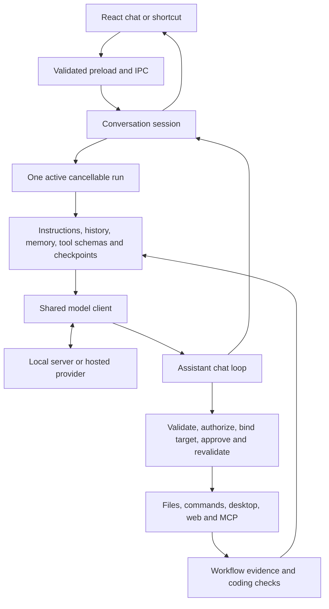

# Sophon runtime architecture

Sophon has one assistant runtime. Chat, coding, desktop actions, research and
visual explanations share its conversation, run manager, model client and tool
execution path. Capabilities depend on settings and permissions, not task modes.
This document is the architectural reference; the linked feature documents
describe components of this runtime.

## Ownership

`workflow/runtime.ts` commits each host `ToolOutcome` once to `ActionLedger`, then
updates the workflow, coding verifier and saved session before publishing them.
The ledger owns mutation revisions, changed paths, check-evidence revisions and
short-lived desktop observation identities. A verification report is valid only
for its run, current mutation revision and current check revision. Possible writes
and interrupted actions invalidate earlier checks; failed rechecks invalidate
saved verification even when no file changed. Resume requires fresh check evidence.

File writes, commands and accessibility controls produce structured status,
execution certainty and evidence. Display text remains model-visible data.
Remaining legacy tools are classified once at `workflow/tool-outcome.ts`; their
string adapters are a migration boundary, not a second completion authority.
`chat.ts` coordinates actions through the runtime rather than maintaining its own
desktop identity map or separately updating three mutation histories.

| Component                                                     | Responsibility                                                                             |
| ------------------------------------------------------------- | ------------------------------------------------------------------------------------------ |
| `src/main/chat/session.ts`                                    | Conversation events, streaming updates, persistence and run lifetime                       |
| `src/main/security/run-manager.ts`                            | One active run, cancellation, policy revocation, shared model-call and action budgets      |
| `src/main/llm/chat.ts`                                        | Context assembly, inference/tool iteration, optional consultations and completion          |
| `src/main/llm/client.ts` and `providers.ts`                   | Shared inference transport, provider formats, streaming and usage                          |
| `src/main/llm/context.ts`, `compaction.ts` and `retention.ts` | Context budgeting, summaries and checkpoint-based retention                                |
| `src/main/llm/tool-discovery.ts`                              | Load relevant schemas from the policy-filtered capability catalog                          |
| `src/main/llm/run-tool.ts`                                    | Shared assistant action gate and approval lifecycle                                        |
| `src/main/tools/index.ts`                                     | Dispatch tools after authorization and argument validation                                 |
| `src/main/workflow`                                           | Evidence, coding checkpoints, project verification and bounded repairs                     |
| `src/main/llm/specialists.ts`                                 | Optional consultations (parallel when batched) using the same model, client and run budget |
| `src/main/memory` and `harness`                               | Personal recall and separately managed procedural guidance                                 |

## Request lifecycle

1. A validated IPC request enters the conversation session and starts one run.
2. The coordinator assembles instructions, current evidence, relevant recall,
   history and permitted tool schemas within the context budget.
3. The shared client calls the selected provider. Provider adapters change wire
   formats, not workflow or authorization.
4. Structured tool batches are validated before actions execute. Each ordinary
   tool passes through `runTool`: policy, budget, concrete target binding,
   approval when required, and target revalidation immediately before dispatch.
5. Results return as untrusted evidence. The workflow tracks observed, reported,
   verified, failed, denied and uncertain outcomes. The coordinator continues or
   responds according to the evidence and remaining budget.
6. The session persists the outcome and releases the run. Stop and policy changes
   cancel the same run, including specialist calls and verification work.

## Proportionate paths

The harness keeps the model's decisions small, which matters most for small local
models. The core prompt states one choice: answer directly, or use tools step by
step and answer from the evidence. Guidance is attached only when it applies: the
generic coding playbook gives way to the coding-session procedure, plugin and
procedural notes appear once those schemas are loaded, the task-checkpoint envelope
appears only after evidence exists or on resume, and GitHub context only when
selected. "Unavailable" entries list only reasons the user can change in Settings.

A plain single-intent desktop command recognised by `requestedDesktopTool` (for
example "Open Calculator") is offered only that tool, plus discovery, on its first
step; the normal working set returns after the first result. When that single call
is host-confirmed (`open_app` reported a window, `focus_window` or `move_window`
verified), the host replies from the result and skips the confirmation-only model
call. Anything unconfirmed goes back to the model as usual. The bounded answer
review runs for mathematics and research drafts, where it checks arithmetic and
sources, and not for ordinary explanations.

Two common small-model detours get one host nudge each per request (`LoopBudgets`
`stall` and `evidence`). A short reply that only announces a next step ("Let me read
the file.") while task tools are loaded is sent back once to take the step or answer.
A request for current information answered without any web call while `web_search`
is loaded is sent back once to search first. Both are prompts, not permissions;
tool policy and approvals are unchanged. A failed or uncertain action result
without a dedicated recovery path (`LoopBudgets.setback`) goes back to the model up
to twice per request, with guidance to diagnose the cause and observe current state
rather than stop or replay the action blindly; a denial still ends the task. Desktop guidance lives in one ordered
playbook (target, observe, act, check), and argument-repair messages carry hints only
for the tools in the rejected batch.

Discovery, questions, design suggestions, coding checkpoints and resource sizing
are coordinator operations handled by the chat loop. They do not provide an
alternative route to execute file, command, desktop or connected-service actions.

The system prompt is ordered stable-first. Values that change between model calls
(remaining calls, actions, seconds and subagent consultations, context usage
against the input budget, and host UI visibility) form one trailing `RUN STATE`
line. Only in-run host notes and the clock come after it. Everything before it stays a reusable prefix for
provider and llama.cpp prompt caches, and the model can see how full its context
is. Above 60% of the budget the line asks for narrower reads and inspections.

Conversation compaction and coding-checkpoint trimming emit `compaction` events.
The reply shows a notice in both the full chat and the shortcut ("Compacting
context…", then what was summarized). This notice does not require diagnostics.

Desktop tool discovery maintains at most eight optional schemas, prioritizing
explicitly loaded tools, related observation/action tools, then recent tools.
The model can pass `unload` to `discover_tools` to drop schemas it no longer
needs. Unloaded schemas stay out until named again, even as related follow-ups.
`consult_specialist` is advertised as a subagent in the compact environment
whenever it is permitted but not loaded. Each subagent runs in its own context
window and appears in the reply in both views, including the docked shortcut bar.
Every selection is intersected with the current permitted catalog; retaining a
schema never retains authorization. Opening an app exposes the inspect/action
loop immediately, avoiding a model call merely to switch between its tools.

Desktop context is a projection of the action log. Expired or superseded control
trees become bounded historical excerpts while the latest live tree stays intact.
Full tool results still reach the action log. Window and observation references
from previous requests are marked expired in model history and workflow targets.

An uncertain control action may trigger at most two host-owned read-backs per
run. The coordinator uses the window reference from the exact originating
inspection, closes any unexecuted calls in the batch, then invokes `inspect_app`
through the normal tool gate and shared action budget. No mutation is replayed.
Denied, unavailable, empty or mismatched read-backs stop recovery. Fresh controls
let the model choose a supported next step without an extra discovery/inference
round-trip; they do not promote the original action's evidence to verified.

## Input, screenshots and queued messages

Desktop input tools (`click`, `move_mouse`, `scroll`, `press_keys`, `type_text`
and the `input_batch` wrapper for known steps) bind to the window the task last
captured. Keys are sent as scan codes and can be held for a set time so games
receive them; `click` accepts `hold_ms`. After input to that window the result
includes a settled screenshot (`capture_after: false` opts out), and within a
batch only the last input captures. `look_at_screen` with `marks: true` draws
numbered boxes on accessible controls so `click` can take a mark that resolves
to coordinates before the normal checks. A window nothing covers is cut from a
monitor capture. Sophon's own visible windows, including the shortcut bar, are
hidden only if they sit in view while it captures; the screen-observation glow
is excluded from capture.

A message sent while a run is active is queued, not rejected. The run reads it at
its next step, and a message that arrives with the final answer keeps the task
going. Messages the task ends before reading start the next task; stopping leaves
them "Not sent".

## Coding within the same loop

Coding adds change tracking, project checks and resumable checkpoints to the
coordinator. It does not start another agent engine. Simple edits require no
saved plan, specialist review or procedural learning. When a plan is saved, its
task statuses and revision must be current before completion. Project edits
invalidate earlier check results; only host-observed checks establish verified
status. Existing code is patched with `edit_file`.

The coordinator assesses its own results. It can request an optional Reviewer
consultation through `consult_specialist`, just like other consultations. There
is no separate mandatory edge/final/repair reviewer pipeline or reserved review
slot. Specialist findings are suggestions from the same model, not independent
verification.

## Authorization and external effects

Tool permissions, coding edit policy, workspace restrictions, web enablement and
GitHub account/repository scope remain enforced by the host. A schema being loaded
does not grant permission. Commands, npm, deletion and MCP operations retain their
one-use approvals. Guidance, memories, summaries and tool output cannot authorize
actions or alter policy.

Direct user actions in settings and the GitHub workspace have explicit IPC
handlers and their own authorization checks. They are user interface operations,
not another model runtime. Assistant-issued operations always use its tool gate.

## Persistence and compatibility

The persisted `mode: 'assistant'` field is a fixed contract marker. No mode-switch
API is exposed. Older saved conversation and workflow modes are normalized at the
storage boundary; the run manager rejects unsupported modes. There are no runtime
offline/desktop/research branches. Research remains a task category, with web
access controlled by settings and tool permissions.

Old coding checkpoints remain readable. Restoring a coding session copies only
the current fields, dropping obsolete forced-review state and invalidating old
verification. Markdown checkpoint files are diagnostic mirrors; encrypted
workflow state is authoritative. Memory and procedural guidance affect context,
never model weights.

## Validation

`npm run build`, `npm run lint` and `npm test` cover compilation and offline
regressions. Security fixtures reject old runtime modes and retain policy,
approval, cancellation and batch-validation coverage. Coding and workflow
fixtures cover optional planning, verification invalidation, checkpoint
restoration and migration of legacy stored modes. Live provider quality and real
desktop behavior require the corresponding opt-in smoke checks.
