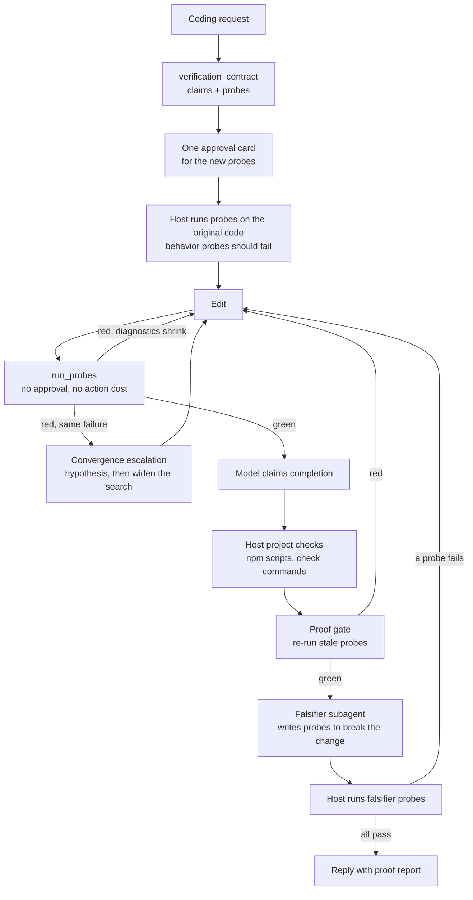

# Proof harness

Runtime ownership and execution flow are defined in [Runtime architecture](ARCHITECTURE.md). This document describes a component of that single assistant runtime: how a coding task gets from "the model says it is done" to evidence that it is.

The coding harness already refused to accept a completion claim without host-observed checks. That made results honest, but not necessarily better: a project's own tests often do not cover the change, the model cannot tell whether a passing test ever exercised its code, a reviewer subagent is the same model agreeing with itself, and fixed retry caps stopped good repairs as readily as bad ones. The proof harness addresses each of these with something the host can check.



## Claims, probes and witnesses

`verification_contract` turns the request into falsifiable claims:

- **behavior**: something the change must make true ("`sum([])` returns 0");
- **guard**: something that must stay true (existing tests, the typecheck);
- **manual**: something that cannot be automated (visual polish); reported as unverified, never as passed.

Each behavior or guard claim has one or more probes. A probe is either one PowerShell check command or a short Node or Python script. It exits 0 when its claim holds and nonzero when it does not. Script probes are stored in the app's `coding-runs/<task>/probes/` folder, not in the user's repository. Node scripts are ES modules with a `workspace(path)` helper for importing project files; Python scripts can import modules relative to the probe folder. `files` lists the test files a probe depends on.

The host runs every new probe immediately, before any edit if the contract came first. Each run is recorded against the mutation revision with:

- the probe's definition hash (command or script, folder, declared files);
- a content hash of the files it depends on (declared files plus file paths named in its command);
- the exit code and a normalized failure fingerprint.

A behavior claim is **witnessed** when one of its probes was observed failing at an earlier revision and passes at the current one, with the same definition and the same dependency hash on both sides. Only that transition shows that the change made the claim true. A probe that passed on its first run is reported as such ("passes, but never observed failing"), and a red→green transition across an edited test file is reported as "its test files changed after it failed". Neither counts as a witness.

Probes can be added, redefined or withdrawn later. Redefining a probe resets its history. Withdrawing a claim or probe needs a reason. Every amendment appears in the final proof, so the model cannot quietly drop a failing check.

## Approval once per task, not once per run

Verification is repetitive: the same probe runs after every fix. One-use approval for every run made that friction prohibitive, so the model rarely re-checked its own work.

A **grant** lets an exact verification command re-run during the current task after the user approved it once. Grants:

- cover only `run_command` with purpose `check` and routine npm check scripts (`test`, `lint`, `typecheck`, `build`, `check`, `smoke`), never change commands, dev servers, installs, `--fix` flags, deletions or MCP calls;
- match the exact command and folder (script probes bind to their stored file path, which includes the definition hash);
- are bound to the run object, so they end with the task, Stop, or any policy change;
- never skip policy, workspace binding or revalidation, which still run on every execution.

New probes from one contract submission share one approval card that shows every command and the full source of every script. Host project checks and checks the model runs itself also become reusable after their first approval, so the host can re-run `npm test` after each fix without asking again. Any other command still asks every time.

Probe runs have their own budget (200 per task) and do not count against the action budget.

## Convergence governor

Fixed caps ("three failures per check", "two setbacks per request") stopped good repairs and wasted bad ones. The governor treats each check and probe as a track and reads each failing run's fingerprint: diagnostic lines with line numbers, timings, addresses and counts normalized away, while error codes such as `TS2322` are kept.

| Observation                                      | Meaning                                    | Effect                                     |
| ------------------------------------------------ | ------------------------------------------ | ------------------------------------------ |
| Turns green, or fewer things fail                | Progress                                   | Earns 3 model calls, 15 actions, 5 minutes |
| Different failure after an edit                  | New information                            | Allowed                                    |
| Failure already seen, after an edit              | Stall (a fix attempt that changed nothing) | Escalates                                  |
| Same failure without any edit                    | Not an attempt                             | Not re-run by the host                     |
| Completion claimed twice on an unchanged failure | Protocol stall                             | Ends the task, unverified                  |

Two stalls push a **hypothesis** step: state a root cause and the observation that would confirm it, and gather it before editing again. Four stalls push **widening the search**: files named in the failure that the model has not read this task, the files it has been editing, a reminder to compare the check with the original request, and the option to revert or consult a subagent. Six stalls, or ten failing runs without the failure shrinking, end the task with an honest report.

Earned budgets apply only to coding sessions and are capped at four times the configured steps (at most 160 model calls), 240 actions and 60 minutes. The run timer re-arms itself, so an extended deadline actually takes effect. RUN STATE shows the earned calls and the rule.

Tool failures outside checks follow the same idea: distinct failed attempts can be diagnosed up to six times between verified changes, while repeating an identical failed call ends recovery at once. Denials always stop.

## Executable adversarial review

A Reviewer subagent runs the same model, so its agreement is not independent evidence. The **falsifier** profile is different in kind: its prose findings are discarded, and only probes count.

The falsifier has read-only `list_files` and `read_file`, up to six model calls, and an assignment with the original request, the contract and the changed paths. It returns up to four probes. The host validates them, shows one approval card, and runs them on the current code:

- a probe that **fails** is admitted as a behavior claim, so the change is broken in a way the coordinator did not test, and the coordinator must fix it. Fixing it later produces a witness automatically, since the probe was observed failing first.
- a probe that **passes** becomes a guard: the attack failed and the property is kept as a regression check.
- a probe that was declined or could not run is withdrawn with that reason.

The coordinator can dispute an admitted probe only by withdrawing it with a reason, and that reason appears in the proof.

## Proof gate and report

When the model claims completion, the host runs, in order:

1. the existing project checks (discovered npm scripts and recorded check commands);
2. every approved probe without a result for the current code; any red probe goes back to the model with its diagnostics, plus any pending escalation;
3. in proof mode, one falsification round when the contract has behavior claims, subagents are enabled and at least four model calls remain.

The reply then carries a proof section:

```text
Proof:
- c-sum: sum([1,2,3]) returns 6 — witnessed (p-sum red at r0 → green at r2)
- c-tests: The existing test script passes — holds (p-tests green)
- [falsifier] f1-1-sum-of-an-empty-list: sum of an empty list is 0 — witnessed (… red at r1 → green at r2)
- Falsification: 1 round, 1 probe broke the change and became claims, 0 did not break it.
```

The coding card gains a **Proof** tab with the same claims, each probe's state, witnesses and the last diagnostics of failing probes.

## Modes

**Settings → Model → Generation → Verification**:

- **Proof** (default): before the first edit of a coding task, a batch that would change code is returned once with a request for a contract; resending the same batch proceeds without a baseline. A coding task finished without a contract is asked once for one. One automatic falsification round runs at the gate.
- **Project checks**: no contract push and no automatic falsification. The contract tools, grants, convergence governor and proof report still work when the model uses them.

Contract tools are offered only in coding sessions where **Run project commands** is permitted, since every probe runs through it.

## Persistence and resume

The contract is saved with the task's workflow state and validated on load. A resumed task keeps its claims, probes and observation history, so an earlier red still counts toward a witness. No approval carries over and no earlier observation counts as current evidence: probes must be approved and run again. Probe runs are tagged as probe evidence. They never mark the task as having unverified mutations and never invalidate project checks.

## Limits

- Probes run with the user's Windows account, like any approved command. They are not sandboxed.
- A witness shows that a probe's verdict changed with the code. It does not show that the probe tests the right thing; that still depends on the claim and the probe the model wrote, which the user sees in the approval card and the report.
- Dependency hashing covers declared files and file paths named in a probe's command, not everything a probe imports.
- Fingerprints are heuristics over text output. Unusual output can make two different failures look alike, or the same failure look different.
- The falsifier uses the same model and can miss defects. Its value is that what it finds is executed, not believed.
- Small local models may struggle with contract-first and probe writing; **Project checks** keeps the lighter path.

## Novelty

Parts of this have precedents: test-driven development's red/green cycle, reproduction tests that must fail before a fix (as in Agentless-style repair pipelines), self-reflection after failures, and multi-agent review. What this harness adds is that the host enforces and records these properties rather than the model narrating them: witnesses are derived from an append-only observation ledger tied to mutation revisions and test-file hashes, adversarial review is admissible only as executed failures, budgets follow measured convergence instead of attempt counts, and repeated verification is cheap because approval binds to an exact check for one task.

## Tests

`npm run smoke:proof` covers fingerprints, contract validation and witness derivation, stale and historical evidence, test-change detection, amendments, persistence, the governor's progress, stall, oscillation and escalation rules, grants, falsifier probe intake, probe files and dependency hashing, ledger tagging, budgets, the tool gate's reuse rules, and the full loop through the real chat loop with a scripted model: the contract-first push, baseline red, witness, host checks, automatic falsification, an admitted probe, the fix and the final report, plus Project checks mode and declined probes. These fixtures establish harness behavior, not the quality gain on any particular model.
