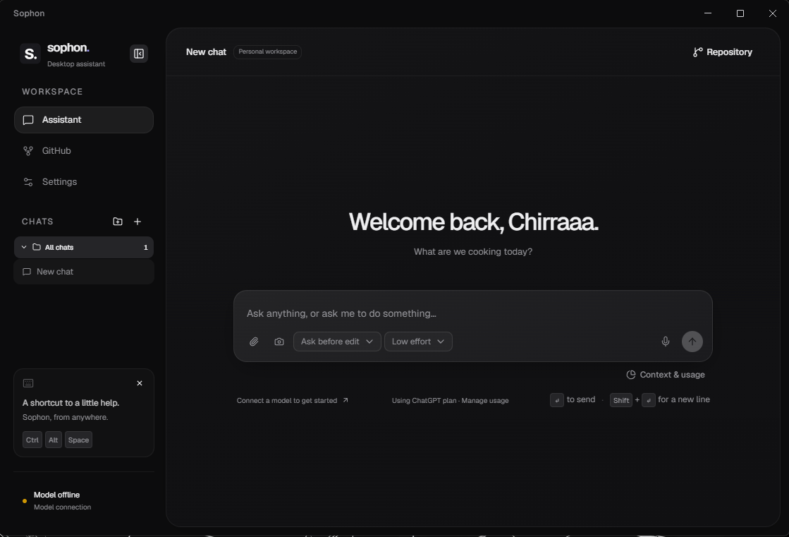
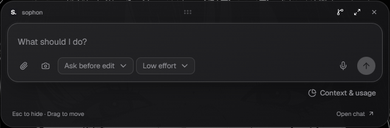
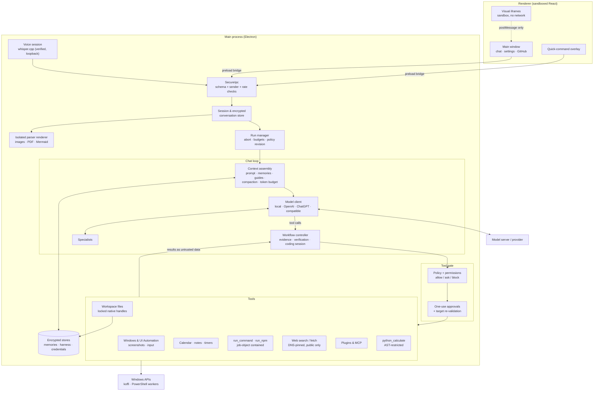

<p align="center"></p>

# Sophon

**A Windows desktop assistant with local-first inference, real desktop tools, and every action gated by permissions you control.**

Sophon talks to a local model (LM Studio or any OpenAI-compatible server) by default, and can optionally use OpenAI (API key or ChatGPT subscription) or another hosted provider. It can chat, research the web, write and verify code, render interactive visuals, and operate your Windows desktop: open apps, read and use controls, move windows, adjust volume. Every tool is **Always allow / Ask first / Block**, enforced by the app itself, not by prompting the model nicely.

Sophon is built to help small local models deliver stronger, more consistent results through careful orchestration, context management, tool controls, and verification; development and testing have included Qwen3.5 4B Q4_0.

**Project status:** Sophon is a work in progress. Bugs, rough edges, and incomplete features may be present. Have fun with it, and if you notice a bug or anything odd, please open an issue with steps to reproduce and any relevant error messages or logs. Feedback and contributions are welcome.

**AI use:** I use AI tools to help develop Sophon at a practical pace, including exploring ideas, writing code, and debugging. I review and test changes, but AI-assisted work can still contain mistakes.

## Screenshots





## Features

- **Local-first models**: LM Studio or another loopback `/v1` server by default, or let Sophon run your own `llama-server` (llama.cpp) with the context size, GPU, memory, thinking and other options you choose; OpenAI Responses, ChatGPT plan sign-in, or any HTTPS Chat Completions provider are opt-in.
- **App interaction**: connected MCP tools, managed Edge/Chrome browser DOM, Windows UI Automation (`inspect_app` / `act_on_control`), then screenshots and coordinates. The model chooses an available route and verifies effects. See [routes and setup](docs/APP_INTERACTION.md).
- **Desktop control**: window management, screenshots, clicks (with optional hold), smooth relative mouse movement, scrolling, typing and key presses (sent as scan codes, with optional hold, so games receive them), audio and Wi-Fi/Bluetooth toggles. Known steps can be batched into one `input_batch` call, input returns a settled screenshot of the window so the model can check the result, and `look_at_screen` can number the window's controls so the model clicks a mark instead of guessing coordinates.
- **Personal organiser**: Outlook / Microsoft 365 calendar events, local notes, and countdown timers shown in the app and the shortcut window. See [Notes and timers](docs/NOTES_AND_TIMERS.md), [Calendar](docs/CALENDAR.md) and [Microsoft accounts](docs/MICROSOFT_ACCOUNTS.md).
- **Agentic coding**: inspect → patch (`edit_file`) → check → repair loop, host-owned verification, patch previews, `run_command` / `run_npm` with exact-command approval.
- **Web research**: Exa (no key), DuckDuckGo, or Brave; bounded public-page reader with PDF support. Off until you enable it.
- **Interactive visuals and images**: HTML/SVG/Mermaid rendered inline in a sandboxed iframe with a small React kit, plus `show_image` for public web images, workspace pictures and screenshots.
- **Voice input**: push-to-talk, transcribed locally with whisper.cpp and the Whisper Base model, chosen intentionally for its lighter resource use.
- **Memory & procedural harness**: encrypted memories that Sophon can save (`remember`), correct, `forget` and `recall` from past chats, with an undo card for every change, plus propose → probe → compose Markdown skills with a trial/active lifecycle. See [Memory harness](MEMORY_HARNESS.md).
- **Plugins & MCP**: import skill packages, connect stdio/HTTP MCP servers; GitHub workspace with device-flow sign-in.
- **Subagents**: `consult_specialist` runs Simple, Researcher, Visual Explainer, Tutor or Reviewer profiles on the same loaded model, in parallel when batched, each with its own context window.
- **Messages mid-task**: send another message (typed or by voice) while Sophon is working and the running task reads it at its next step.
- **Quick command and dock**: global shortcut (`Ctrl+Alt+Space`) opens a compact bar; `Ctrl+Alt+V` for voice. The bar stays over borderless and fullscreen games without taking focus, and can alert you from the top of the screen when a task finishes or needs approval (Settings → General). It stays visible in screenshots and streams and steps aside only while Sophon captures the screen.

## Architecture

Sophon uses one assistant runtime for all tasks. See [Runtime architecture](ARCHITECTURE.md) for component ownership, execution boundaries and persistence compatibility.



**Request lifecycle:** the renderer sends text through a validated IPC channel → the run manager creates an abortable, budgeted run → context is packed within the model's window (history summarized when needed) → the model replies with text or structured tool calls → each batch is schema-validated, then every call passes policy and (when required) a one-use approval with the target window/file/command re-checked just before execution → results return to the model wrapped as **untrusted data** and the host records evidence (`observed`, `reported`, `verified`, `failed`…) so completion claims are checked against what actually happened.

### Design principles

- **Permissions are enforced in code**: tool schemas are filtered per request, then re-authorized at execution. Commands, deletions and MCP calls always need one-use approval.
- **Everything the model reads is untrusted**: files, web pages, screenshots, memories, tool output are enveloped and cannot grant permission.
- **Defense in depth**: sandboxed renderers with a strict CSP and a deny-all Chromium proxy, contract-checked IPC, native handle locking for workspace files, encrypted storage via OS-protected keys, job-object–limited workers.
- **Honest verification**: accepted input ≠ success. Tools read back state where possible; unverifiable outcomes are reported as such.
- **Inference-time learning only**: memory and harness guidance change prompts, never model weights.

## Getting started

**Requirements:** Windows 10/11, Node.js 20+, and a model server (e.g. [LM Studio](https://lmstudio.ai) with a model loaded, serving at `http://127.0.0.1:1234/v1`, or a `llama-server.exe` you choose in Settings → Model → Runtime). Python 3 on PATH is needed for `python_calculate`; Git for the GitHub checkout and coding tools.

```bash
git clone https://github.com/Chirraaa/sophon.git
cd sophon
npm install
npm run setup:voice   # optional: builds pinned whisper.cpp (needs VS C++ tools + CMake)
npm run dev
```

On first launch, open **Settings → Model** to pick your provider and model, **Settings → Files** to choose a working folder, and **Settings → Permissions** to decide what Sophon may do. New profiles start with every tool on _Ask first_; web access is disabled until enabled.

> Match **Settings → Model → Context window** to your server's loaded context size; Sophon budgets history, tools and reply space from it.

### Scripts

| Command                              | Purpose                                                                                                                                                           |
| ------------------------------------ | ----------------------------------------------------------------------------------------------------------------------------------------------------------------- |
| `npm run dev`                        | Development with hot reload                                                                                                                                       |
| `npm run build`                      | Typecheck + production build                                                                                                                                      |
| `npm run lint` / `npm run typecheck` | Static checks                                                                                                                                                     |
| `npm test`                           | Offline regression suites (no model or account needed)                                                                                                            |
| `npm run smoke:*`                    | Targeted checks (security, coding, workflow, UI, voice…)                                                                                                          |
| `npm run build:win`                  | Signed Windows installer (requires a code-signing certificate)                                                                                                    |
| `npm run build:win:unsigned`         | Unsigned Windows installer for local testing or releases without a signing certificate (only English Chromium resources are bundled; Whisper Base stays included) |

## Project layout

| Path                         | Responsibility                                                      |
| ---------------------------- | ------------------------------------------------------------------- |
| `src/main/app`               | Windows, tray, shortcuts, IPC registration                          |
| `src/main/llm`               | Model client, providers, prompt, context packing, tool loop         |
| `src/main/workflow`          | Evidence tracking, coding session, verification, budgets            |
| `src/main/tools`             | Desktop, file, command, calendar, notes, timer and device tools     |
| `src/main/services`          | Calendar, notes, timers, screen glow, fullscreen detection, updates |
| `src/main/security`          | Policy, run manager, IPC contracts, workspace handles, credentials  |
| `src/main/network`           | Bounded model/search/page transports and URL policy                 |
| `src/main/harness`, `memory` | Procedural skills, encrypted memories and conversation recall       |
| `src/main/plugins`           | Plugin import, MCP runtime, GitHub integration                      |
| `src/main/voice`             | Whisper process and recording session                               |
| `src/renderer`               | React UI (shadcn / Base UI components)                              |
| `src/shared`                 | Types and contracts shared across processes                         |

## Docs

- [Security implementation record](SECURITY_IMPLEMENTATION.md)
- [Coding harness](CODING_HARNESS.md) · [Coding workflow](docs/CODING_WORKFLOW.md)
- [Memory harness](MEMORY_HARNESS.md) · [Evolving harness](EVOLVING_HARNESS.md)
- [Agent / subagent design](AGENT_SYSTEM_DESIGN.md)
- [Desktop interaction](DESKTOP_INTERACTIONS.md)
- [App interaction routes](docs/APP_INTERACTION.md)
- [Calendar](docs/CALENDAR.md) · [Notes and timers](docs/NOTES_AND_TIMERS.md) · [Microsoft accounts](docs/MICROSOFT_ACCOUNTS.md)
- [Plugins & MCP](docs/PLUGINS_AND_MCP.md) · [GitHub workspace](docs/GITHUB_WORKSPACE.md)
- [Release & update publishing](docs/updates.md)

## Security notes

Sophon can act on your machine with your Windows account's permissions. Approved commands, npm scripts and local MCP servers are **not sandboxed**; review them before allowing. Small local models can make mistakes, so keep important work under version control. Please report vulnerabilities privately rather than in public issues.

## Contributing

Issues and pull requests are welcome. Before submitting, run `npm run build`, `npm run lint` and `npm test`. Prefer the project's shadcn components for UI, use styled inline validation (no native browser dialogs), and keep security boundaries intact: new tools need a schema, a registry entry, a policy/approval path and a test.

## License

Sophon is source available under the [PolyForm Noncommercial License 1.0.0](LICENSE).

You may use, study, modify, and share Sophon for noncommercial purposes under the license's terms. Selling Sophon or modified versions, offering it as a commercial service, or reusing its code in commercial products requires separate permission from the copyright holder. The license also expressly permits use by the noncommercial organizations it lists, including schools, charities, and government institutions.

Because commercial use is restricted, this is a source-available project rather than open source under the [Open Source Definition](https://opensource.org/osd). Third-party dependencies retain their own licenses. See [licensing and attribution](NOTICE.md) and [third-party notices](THIRD_PARTY_NOTICES.txt), including font, model and source-availability notices.
