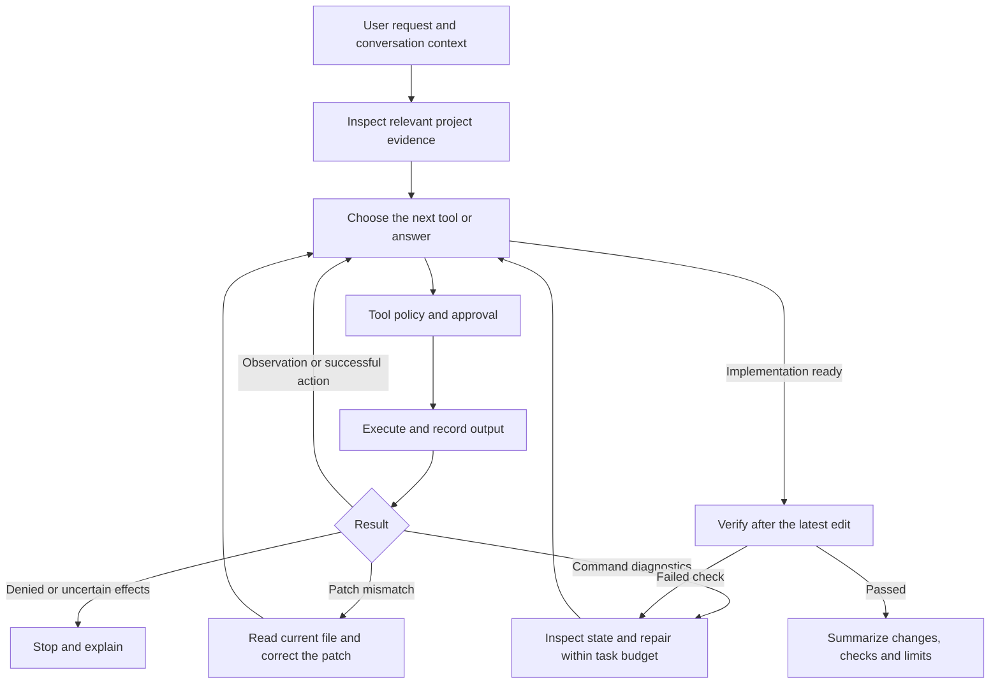

# Coding workflow for testing

Runtime ownership and execution flow are defined in [Runtime architecture](../ARCHITECTURE.md). This document describes a component of that single assistant runtime.

The default path is one assistant loop: understand the request, inspect the project,
act through approved tools, inspect results, and repair diagnosed failures. Planning
checkpoints and specialist consultations are optional. Reading a repository or
running an existing command does not require a saved plan or review call.

`run_command` runs a PowerShell command in an existing workspace-relative folder.
It supports installed tools such as Git, Java/javac, Maven/Gradle, C/C++ compilers,
Make, CMake, CTest and Ninja. Each invocation shows the exact command and folder
for one-use approval; a `check` command the user approved can re-run during the same
task without asking again (see [Proof harness](../PROOF_HARNESS.md)). Output is streamed and capped. The timeout defaults to 120
seconds and can be set from 1 to 600 seconds. Stop and timeout terminate the
process tree. Commands run with normal Windows account and network access;
the working directory is not an execution sandbox. Existing blocked tools and
GitHub account/repository constraints still apply. Use PowerShell syntax and
one logical command per call; use `npm.cmd` if Windows blocks `npm.ps1`.

Set `purpose` to `inspect`, `change`, or `check`. Check results are tied to the
current source revision: an edit invalidates earlier passes. npm projects retain
host-discovered script verification. Other projects use actual build/test
commands chosen from the project's instructions. Missing checks or tools are
reported without inventing an npm project. Build tools must be installed/on PATH;
the runner does not install them automatically. `run_npm` continues to manage
long-running dev servers.

The trace retains failed attempts. A patch mismatch or missing-path failure that
guaranteed no write can be resolved by a later verified action on the same target.
Denials and uncertain effects cannot be retried automatically. Repeated check
failures stop after three attempts. “Continue,” “try again,” “go ahead,” and replies
from the question UI retain the original request and refresh execution evidence.

Verification: `npm.cmd run smoke:coding:harness`,
`npm.cmd run smoke:project-commands`, `npm.cmd run smoke:coding`,
and `npm.cmd run smoke:coding:ui` (after `npm.cmd run build`).

`npm.cmd run smoke:coding:connected` explicitly uses the current ChatGPT model
and consumes its normal usage. It exercises the production renderer, IPC, chat
loop, approvals and tools in a disposable profile/project: inspection, a checked
code fix, local Git commit, short follow-ups, Java compilation, and C/C++ builds
with Make. Credentials remain encrypted, the temporary copy cannot refresh or
rotate the main app's tokens, and its credential file is removed afterward.
The test requires a currently valid connection plus Git, Node, Java/javac,
GCC/G++ and mingw32-make on PATH. Reports contain only synthetic fixture activity.
